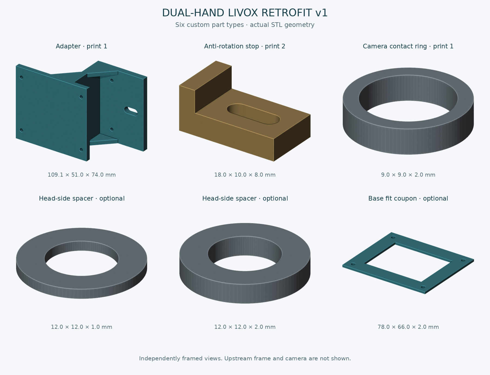
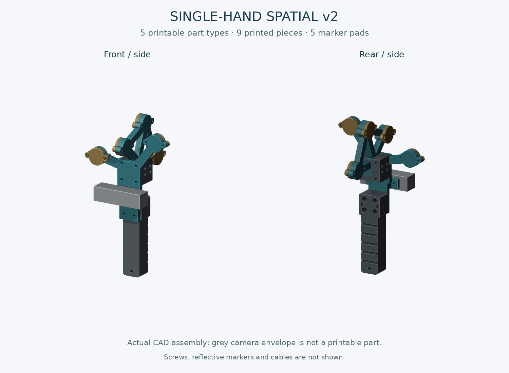

# HandleSlamModel

三款 D435i 支架模型。单位为 **mm**，共 **14 份 STL + 14 份 STEP**。STL 为打印姿态，STEP 为可编辑实体的装配坐标。

| 模型 | 版本 | 零件数据 | 用途与状态 |
| --- | --- | --- | --- |
| [双手 Livox 改装](mounts/dual_hand_livox_v1) | v1 · 2026-09-30 | 6种新增件，含可选垫片/试片；主架约109.1×51×74 mm | 安装D435i的适配组件；不含上游整机原件，实装版本未核对 |
| [单手空间动捕架](mounts/single_hand_spatial_v2) | v2 · 2026-10-10 | 5种，共打印9件；主框架154.4×157×20 mm | 单手握柄与5个可换点座；待实物验证的空间点阵原型 |
| [笔记本 B1 双夹](mounts/laptop_b1) | B1 · 2026-10-11 | 3种；主件1、压脚2，另有可选试片；主件153.5×173×134 mm | 面向MateBook EMF-16的D435i夹架；尚未实装精配 |

## 双手款：6种自制适配件

## 单手款：空间动捕架 v2

## 笔记本款：B1 双夹原型

图片来自模型数据；灰色设备为示意包络，不是可打印零件，也不表示已通过实物测试。

许可：[GPL-2.0-only](LICENSE)。[参数化源文件（原始发布版本）](https://github.com/HITZY2002/HandleSlamModel/tree/8d42686b1fcbf6940ed3b2d7bd6f05b8320b2354/mounts)。双手款参考 Jiarong Lin / HKU MARS 的 [Livox_handheld](https://github.com/hku-mars/Livox_handheld/tree/31def48c50816932e5c5043d54c80a51fb80a6bf)。
