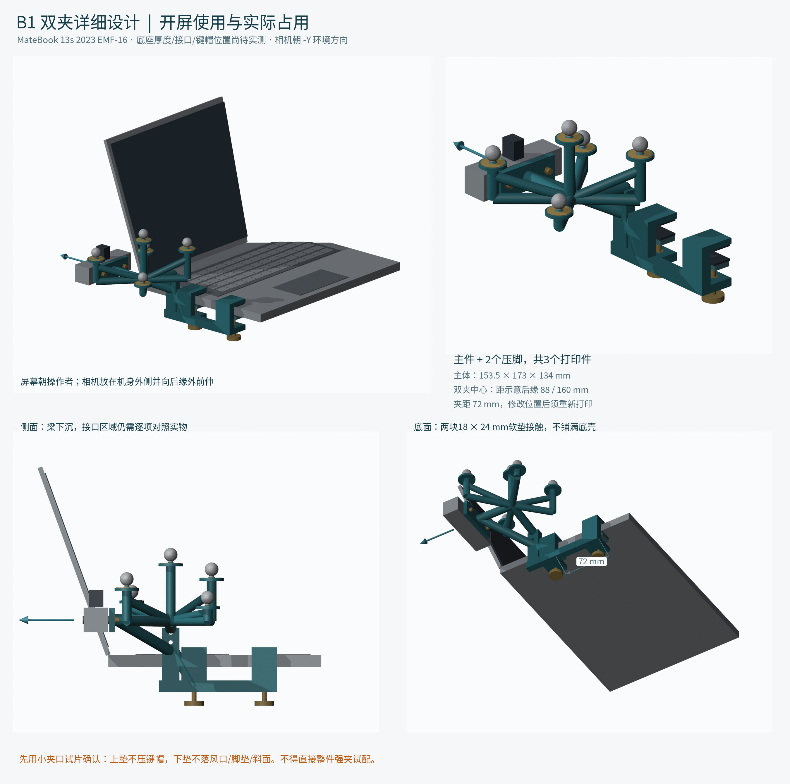

# B1 笔记本双夹 / Laptop dual-clamp prototype

2026-10-11 设计。D435i 相机架与5个 Ø25 mm空间错层粘贴座一体；两个夹口固定在笔记本**底座**侧边。正式打印主件1件、活动压脚2件，另有可选试片。

**从未实装验收。不是已精配的 MateBook EMF-16 产品。** 12 mm底座厚度、110°开屏角和电脑包络均为示意值；须先量真实夹点、硬边、接口、散热口、脚垫及开盖路径。用户始终双手托电脑，严禁提支架搬电脑。

This B1 is a trial design, not an exact-fit or load-certified EMF-16 mount. Base thickness and lid angle are illustrative. Only clamp thickness is mechanically adjustable; changing clamp spacing/location requires editing CAD and reprinting.



## 阅读顺序 / Read first

1. [中文完整说明](README_先读.txt)、[BOM](BOM.md) 与 [打印/装配](PRINT_ASSEMBLY.md)
2. [原型手册完整文字](docs/B1_原手册完整文字.txt) 与 [已知问题](../../docs/KNOWN_ISSUES.md)
3. 先试片及一个压脚，在手托电脑时轻试；接触、避让和夹力不明确则不要装主件移动电脑

The complete manual text and four annotated previews are derived from custom CAD, with illustrative camera/laptop/hardware envelopes. They show design intent, not evidence of a physical test.

## 文件与重建 / Files and rebuilding

- `STL_PROTOTYPE/`: 3种可打印几何；只打印主件、压脚、试片。
- `STEP/`: 独立可编辑实体，装配坐标。
- `params.json` + `build_B.py`: 参数化 CAD 源，CadQuery 2.7.0 / NumPy。
- `QA.json`、`STL_validation.json`、`STEP_validation.json`: 原数字检查记录。
- `render_B.py`、`make_figures.py`、`make_manual.py`: 自制预览和手册生成源。运行渲染链还需 Blender 4.3.2、Pillow、Matplotlib、ReportLab 和适合的中文字体。不是打印或 CAD 重建的依赖。

```sh
python mounts/laptop_b1/build_B.py
python mounts/laptop_b1/verify_stl.py
```

先复制目录。重新制图须按原脚本顺序 build → verify → Blender render → figures → manual；修改尺寸后必须同步图注和手册，旧尺寸图不会自动成为新工程图。

Physical fit, shell pressure, slip resistance, print support removability, heat/creep, cable route, optical FOV and tracking visibility remain unvalidated. See [GPL-2.0-only license scope](../../LICENSING.md).
